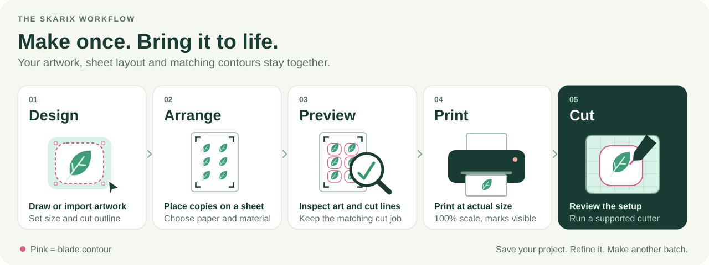
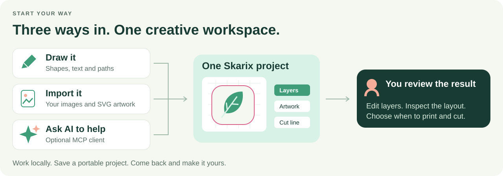

# Skarix — Open Source Cutting Studio

<p><strong>Make your own stickers, labels and decals, from the first shape to the final cut.</strong></p>
<p>Turn an idea, an image or an SVG into artwork, an arranged sheet and matching print and cut files.</p>

Design in real dimensions, refine your artwork in layers, and keep your projects on your own computer. Skarix is free, open source, and available for Windows, macOS and Linux. Local artwork, editing and exports work without a cloud account.

[Download Skarix](https://github.com/doudar/Skarix/releases/latest) · [Your first project](#start-your-way) · [Print & cut guide](docs/CRICUT-WORKFLOW.md) · [Cutter support](#choose-your-cutter-workflow)

## Get Skarix

**Latest stable release: [v0.21.2](https://github.com/doudar/Skarix/releases/tag/v0.21.2).** Download for your platform below. Visit [latest release](https://github.com/doudar/Skarix/releases/latest) for current installers and release notes as new versions arrive.

| Your computer | Download v0.21.2 |
| --- | --- |
| **Windows** | [64-bit installer (.exe)](https://github.com/doudar/Skarix/releases/download/v0.21.2/Skarix-0.21.2-win-x64.exe) |
| **macOS** | [Universal installer for Apple Silicon and Intel (.dmg)](https://github.com/doudar/Skarix/releases/download/v0.21.2/Skarix-0.21.2-mac-universal.dmg) |
| **Linux** | [64-bit AppImage](https://github.com/doudar/Skarix/releases/download/v0.21.2/Skarix-0.21.2-linux-x64.AppImage) |

Install the desktop app, open it, and choose **Meet Skarix** to explore an editable starter sticker. Already installed? Open **Settings → Updates** to check for a newer version. See [installation and setup](docs/INSTALLATION.md) for platform details.

## Why Skarix?

| Feature | What you can do |
| --- | --- |
| **Your own studio** | Make product labels, planner stickers, decals or a one-off illustration. Start blank, import artwork, or take apart the editable starter sticker. |
| **Editable artwork** | Build with text, shapes and Bézier paths. Add gradients, textures and shadows; organize layers into groups; reuse repeated details. |
| **Precise layouts** | Set physical dimensions, align designs, arrange copies and nest a sheet. Inspect the cut boundary before using material. |
| **Print and cut** | Prepare marked pages and matching contours in one project. Choose materials, pressure and passes, then review the output. |
| **Local projects** | Keep working drafts on your computer and save portable project files with your editable designs. Existing sticker projects remain readable. |
| **Optional AI design** | Let an MCP client help create and refine artwork in the live editor, with Undo. You review the result and operate the printer and cutter. |


## From artwork to cut

1. Choose **Meet Skarix**, **Blank canvas**, or **Open project** on Home.
2. Create or import artwork in **Design studio**. Use **Add shape**, text and drawing tools, set the physical dimensions, and inspect the pink cut outline.
3. Arrange copies on your sheet and choose the exact machine, paper and material.
4. Open **Print & cut**, inspect the pages, and print at **actual size / 100%**.
5. Review the matching cut job, check the material and mat, then operate the supported cutter. Follow the [print and cut guide](docs/CRICUT-WORKFLOW.md) for setup and alignment.



**Artwork and cut lines are separate.** Effects change how a design looks; the pink contour shows where the blade goes. Use **Fit Cut** or **Cut border** to adjust the outline, then inspect it before printing. Imported image silhouettes are not automatically traced.

## Start your way



- **Make something from scratch.** Choose **Blank canvas**, add shapes and text, and set your dimensions in millimeters. Try gradients or a texture, then group related layers so you can move them together.
- **Bring your own artwork.** Import an image or SVG, size it for the finished piece, and adjust its cut boundary. Use a non-printing reference overlay when you want to draw against a photo.
- **Explore before you commit.** Choose **Meet Skarix** and change the starter's colors, lettering or layers. The [Aurora example](examples/README.md) is another editable project to learn from.

For a first print, make a small sheet of copies, save the project, and test alignment on inexpensive material. Once it looks right, reuse the layout for your next batch.

### Prefer to design with AI?

Open **Settings → AI design**, choose **Start AI design access**, and **Copy MCP configuration** into a trusted MCP client. Keep Skarix open while the client edits your artwork or sheet layout. You can inspect previews, refine the layers yourself, and Undo changes.

Skarix remembers whether access was enabled and restores it next session if you leave it on. Choose **Stop AI design access** to disable future automatic starts. Printing and cutter operations remain manual. See the [AI design setup and tool guide](docs/AI-DESIGN-MCP.md).

## Choose your cutter workflow

You can create artwork and prepare files before connecting hardware. Direct cutter support depends on the model and operating system; a model appearing in the selector does not mean a direct driver is available.

| Cutter / connection | Current direct support |
| --- | --- |
| **Explore 5 · Windows USB** | Verified workflow; preferred Windows connection. Windows Bluetooth is experimental. |
| **Explore 5 · macOS Bluetooth LE** | Connection and cutting have been physically tested. |
| **Maker 5** | Experimental connection and registered cutting; requires a Maker 5 material profile. Not physically tested. |
| **Joy 2** | Experimental connection only. This Letter/A4 workflow cannot prepare its smaller registered sheets. |
| **Other Cricut models, Linux direct cutting, Silhouette** | No implemented direct driver for this workflow. Check the guide before planning a hardware setup. |

Direct Cricut control uses inspected components from an installed Design Space runtime on Windows or macOS. Read the [hardware setup, material and print instructions](docs/CRICUT-WORKFLOW.md) before connecting. Test a new material or layout before making a full batch.

## Keep your work and keep creating

Use Undo/redo while editing, and save portable **`.skarix.json`** project files to keep your editable artwork and layout. Local drafts help you resume; saved files give you a project you can back up or move to another computer.

| Need a hand? | Go here |
| --- | --- |
| Install, update or recover existing projects | [Installation guide](docs/INSTALLATION.md) |
| Print, choose materials or connect a supported cutter | [Print & cut guide](docs/CRICUT-WORKFLOW.md) |
| Learn layers, paths, effects, repeats and layouts | [Feature guide](docs/FEATURES.md) |
| Connect an AI client | [AI design guide](docs/AI-DESIGN-MCP.md) |
| Report a problem or suggest an improvement | [GitHub issues](https://github.com/doudar/Skarix/issues) |

## Build from source

For development, use Node.js 22 or newer:

```sh
npm ci
npm run desktop
```

Use `npm run dev` for browser development. Direct cutter access and desktop printing require Electron. Run `npm test` and `npm run build` before submitting changes. See [Contributing](CONTRIBUTING.md) and [Architecture](docs/ARCHITECTURE.md) for development details.

## License and credits

Skarix takes its name from *skära*, the Swedish word for cutting with a blade, and the open-source *-ix* tradition. It is based on [CriProx](https://github.com/Go2Engle/CriProx), created by [Chris Engle (Go2Engle)](https://github.com/Go2Engle) and its original contributors.

Skarix is licensed under **GPL-3.0-only**. Please preserve upstream attribution and copyright notices. See [LICENSE](LICENSE), [NOTICE](NOTICE), and [THIRD_PARTY_LICENSES.txt](THIRD_PARTY_LICENSES.txt). Skarix is independently maintained and not affiliated with Cricut.
